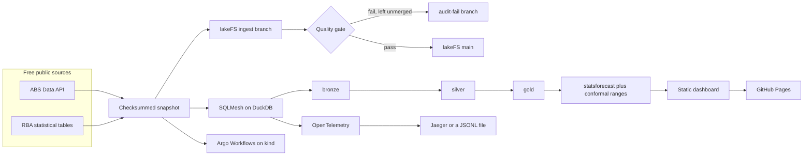

# Living cost squeeze

[](https://github.com/LuciferDataEngineer/living-cost-squeeze/actions/workflows/ci.yml)
[](https://luciferdataengineer.github.io/living-cost-squeeze/)

**Live dashboard:** https://luciferdataengineer.github.io/living-cost-squeeze/

Who is losing the cost-of-living race in Australia? Employee living costs rose **5.1%** over the year to September 2026. Prices rose **3.9%**. Wages, last published for the year to June, rose **3.2%**. Since September 2021, employee living costs are up **28.9%** and wages **17.6%**, both measured to June 2026.

The September wage result is due on 18 November 2026 and is not in the extract yet. The estimate for that print is **3.2%**, inside a wider range of **2.9% to 3.6%**. The numbers, and what they do not say, are in [INSIGHTS.md](INSIGHTS.md).

This is portfolio project 14. It is a local, free, reproducible pipeline for the decision in front of pension indexation, the Fair Work annual wage review, and household policy: which households and states are falling behind prices and pay, how much mortgage interest is driving the employee index, and what the next quarter looks like once past misses are taken seriously.

## Architecture



The snapshot is the system of record for a run. lakeFS is the publish gate: files are written to a branch, checked, and merged to `main` only if the check passes. SQLMesh builds the warehouse from that same snapshot. The estimate and the dashboard read the warehouse. Argo runs the same steps as containers. Traces record how long each step took.

## What's new vs the previous project

[road-toll-reversal](https://github.com/LuciferDataEngineer/road-toll-reversal) published a data-mesh lakehouse: DuckDB, ODCS contracts, Iceberg on Apache Polaris with MinIO, Airflow 3 assets, a PyMC hierarchical model, a ClickHouse benchmark, and Helm on kind.

This project steps up the governance and the forecast, and drops the pieces that do not serve this question.

| Concern | Project 13 | This project |
| --- | --- | --- |
| Publish gate | Iceberg tables in a Polaris catalog | lakeFS write-audit-publish on MinIO. A failed audit stays on its own branch and is not merged. |
| Transforms | dbt-style models in earlier projects; SQL inside the mesh job in project 13 | SQLMesh on DuckDB: bronze, silver, gold, `plan`/`apply`, built-in audits, a unit test, and virtual environments `prod` and `dev` |
| Orchestration | Airflow 3 asset DAG | Argo Workflows, installed with Helm on kind, as a four-step container DAG |
| Observability | Task logs | OpenTelemetry spans, Jaeger locally, a JSONL exporter in CI, with step times below |
| Model | PyMC small-area rates | statsforecast with conformal ranges and a 20-quarter walk-forward check |
| Warehouse | DuckDB, plus ClickHouse for a benchmark | DuckDB only |

## Tech stack

| Piece | Why it is here |
| --- | --- |
| [DuckDB](https://duckdb.org/) | The warehouse. One file, no server, no paid engine. SQLMesh and the estimate both read it. |
| [SQLMesh](https://sqlmesh.com/) | Transformations with a plan, audits, a unit test, and virtual environments. It replaces dbt for this project. |
| [lakeFS](https://lakefs.io/) | Branch, check, merge. `main` only moves when the living-cost extract passes the gate. |
| [MinIO](https://min.io/) | The S3 blockstore under lakeFS. Docker Hub and dl.min.io no longer serve the server anonymously, so `docker/minio` packages the public AGPL release binaries from GitHub. Still free, still local. |
| [Argo Workflows](https://argoproj.github.io/workflows/) | The pipeline as a DAG of containers: audit, transform, estimate, publish. |
| [kind](https://kind.sigs.k8s.io/) and [Helm](https://helm.sh/) | A local Kubernetes cluster in CI, with no cloud account. |
| [OpenTelemetry](https://opentelemetry.io/) and [Jaeger](https://www.jaegertracing.io/) | One span per step. Jaeger when it is running; a JSONL file otherwise. |
| [statsforecast](https://nixtlaverse.nixtla.io/statsforecast/) | Next-quarter estimates. Conformal intervals come from the library's walk-forward errors. |
| pytest, ruff, GitHub Actions, GitHub Pages | Tests, lint, CI, and the public page. All on the free tier. |

No paid cloud, no API key, no hosted database. Postgres is not used.

## Data sources

Downloaded 12 November 2026 by `scripts/refresh_snapshot.py`. ABS series are [CC BY 4.0](https://www.abs.gov.au/website-privacy-copyright-and-disclaimer). RBA tables are free to reuse with attribution. Checksums, byte sizes and row counts are in [data/manifest.json](data/manifest.json).

| Series | Publisher | URL | Licence | Coverage | Notes |
| --- | --- | --- | --- | --- | --- |
| Selected Living Cost Indexes | ABS | [LCI on the Data API](https://data.api.abs.gov.au/rest/data/LCI) | CC BY 4.0 | 2004-Q1 to 2026-Q3 | Employee, age pensioner, other government transfer, self-funded retiree, and the pensioner and beneficiary benchmark. National only. |
| Change in contribution | ABS | same dataflow, measure 5 | CC BY 4.0 | 2025-Q4 to 2026-Q3 | Used for the mortgage share of the latest quarterly rise. |
| Living-cost weights | ABS | [LCI_WEIGHTS](https://data.api.abs.gov.au/rest/data/LCI_WEIGHTS) | CC BY 4.0 | 2022-Q3 to 2024-Q4 | Interest charges. A separate mortgage weight is not in the API. |
| Wage Price Index | ABS | [WPI](https://data.api.abs.gov.au/rest/data/WPI) | CC BY 4.0 | 2004-Q1 to 2026-Q2 | Total hourly rates excluding bonuses. Seasonally adjusted nationally. States are original. |
| Wages by industry | ABS | same dataflow | CC BY 4.0 | 2012-Q1 to 2026-Q2 | Divisions B–S, original. Agriculture returns HTTP 404. |
| Consumer Price Index | ABS | [CPI](https://data.api.abs.gov.au/rest/data/CPI) | CC BY 4.0 | 2004-Q1 to 2026-Q3 | All-groups index, eight capitals and the weighted average. |
| Unemployment rate | ABS | [Labour force](https://data.api.abs.gov.au/rest/data/LF) | CC BY 4.0 | 2015-01 to 2026-09 | Seasonally adjusted, persons. NT and ACT are absent. |
| Cash-rate decisions, table A2 | RBA | [a2-data.csv](https://www.rba.gov.au/statistics/tables/csv/a2-data.csv) | Free with attribution | 1990-01-23 to 2026-11-04 | Exact response bytes, plus a tidy extract. |
| Cash-rate monthly average, table F1.1 | RBA | [f1.1-data.csv](https://www.rba.gov.au/statistics/tables/csv/f1.1-data.csv) | Free with attribution | monthly, through 2026-10-31 | Exact response bytes. |

The API needs no key. Nothing was filled in when a series was missing. The gaps are listed under Limitations.

## Cleaning and transforms

1. Download the SDMX CSV for each key. Record the URL, the access date, the gzip checksum, and the row count.
2. Lower-case the header. Values are unchanged. RBA A2 and F1.1 are also stored as the exact bytes that came back.
3. Parse the RBA preamble into a tidy cash-rate file: one row per decision and one row per month.
4. Quality gate, on the files and again on the bytes read back from lakeFS: known household and region codes, no empty values, indexes and annual changes inside the ranges seen in this history, and a minimum row count.
5. SQLMesh `bronze` reads the gzip files. `silver` pivots living-cost measures, computes the annual price change as index(t) / index(t−4) − 1, and splits wages into the national headline, the states, and industries. `gold` is the household gap, the state gap, and the mortgage contribution.
6. The estimate reads the silver index levels, walks forward 20 quarters, and writes `published.nowcast`.

The published employee annual change of 5.1% matches the index ratio rounded to one decimal (105.05 / 100.0 − 1). The price change is calculated because `CPI/3.10001...` returned HTTP 404 on the access date.

## Data model

| Layer | Model | Grain |
| --- | --- | --- |
| bronze | `lci`, `lci_weights`, `wpi`, `cpi`, `unemployment`, `cash_rate` | one source row |
| silver | `lci_quarter`, `lci_all_groups` | quarter × household × item, then all-groups only |
| silver | `cpi_quarter`, `cpi_national` | quarter × capital, then Australia |
| silver | `wage_national`, `wage_state`, `wage_industry` | the headline, each state, each division |
| gold | `household_gap` | quarter × household, with the wage gap and the gap versus prices |
| gold | `state_gap` | quarter × state, pay minus capital-city prices |
| gold | `mortgage_quarter` | quarter × household, including the share of the quarterly rise |
| published | `nowcast`, `nowcast_backtest` | one row per series, and one row per past quarter |

`sqlmesh plan prod` is the physical environment. `sqlmesh plan dev --include-unmodified` creates a virtual environment over the same tables. In this DuckDB file those views are `gold.household_gap` and `gold__dev.household_gap`. Both returned 438 rows on this run. The dev environment uses SQLMesh's default one-week expiry.

A unit test in `tests/test_household_gap.yaml` feeds a quarter where pay grows 3 points and living costs grow 4, and expects a gap of −1.

## Step timing

From `make pipeline` on 12 November 2026. The trace file is `data/traces/pipeline.jsonl` when a run is local, and the summary is committed at [data/perf/timings.json](data/perf/timings.json).

| Step | Time |
| --- | ---: |
| Quality gate | 61 ms |
| SQLMesh `prod` | 1.6 s |
| SQLMesh `dev` | 1.6 s |
| Estimate, 7 series × 20 windows | 493 s |
| Dashboard | 30 ms |
| **Total** | **496 s** |

The snapshot is **192 KB** across 10 files (15,497 living-cost rows, 7,380 wage rows, 4,176 industry rows, 819 price rows, 987 unemployment rows, 535 tidy cash-rate rows). The DuckDB file is **8.4 MB**. Cost is **$0**: local DuckDB, local Docker, GitHub Actions and Pages on the free tier, and no-key public APIs.

Almost all of the runtime is the estimate. Each series refits a seasonal baseline and an automatic ARIMA on 20 expanding windows so the range is built from real past errors. Rebuilding the page from a warehouse that already exists takes about 30 ms. The Argo DAG uses the seasonal baseline only (`NOWCAST_FAST=1`) so the free runner is not repeating that search. The full search runs in the core CI job and in `make pipeline`.

To see the spans in Jaeger:

```bash
docker compose up -d jaeger
OTEL_EXPORTER_OTLP_ENDPOINT=http://127.0.0.1:4318 make pipeline
```

The UI is at http://127.0.0.1:16686.

## How to run

```bash
python3 -m pip install -r requirements.txt
make pipeline    # quality gate, SQLMesh prod and dev, estimate, dashboard
make lint
make test
```

`make snapshot` re-downloads the ABS and RBA files and rewrites `data/manifest.json`.

lakeFS, on MinIO:

```bash
make lakefs
```

That starts MinIO, creates the bucket, starts lakeFS, writes the snapshot to an `ingest` branch, merges it after the gate, then loads a bad file on `audit-fail` and asserts that branch is not merged. The API is at http://127.0.0.1:8000 (the sample installation keys from the lakeFS quickstart, local only). Jaeger is in the same compose file.

Argo on kind:

```bash
make argo
```

This builds the project image, creates a one-node cluster, installs Argo Workflows with Helm, and runs `argo/workflow.yaml`. The publish step prints `EMPLOYEE_LCI_YOY_2026Q3=5.1`.

The dashboard files are in `site/`. GitHub Pages publishes that directory from `main`.

## Testing and CI

`make ci` runs ruff, `sqlmesh test`, the pipeline, and pytest.

- Snapshot checksums and value ranges, including a file that must fail.
- The SQLMesh unit test for the wage gap.
- The fast conformal path: the range contains the point, and the wider band contains the tighter one.
- Warehouse checks against this snapshot: employee living costs 5.1% in 2026-Q3, wages 3.2% in 2026-Q2, prices 3.9%, every state gap negative, cash rate 4.85%, and `prod` and `dev` row counts equal.
- Dashboard contract: four pages, 3–5 number cards, at most three supporting charts, no pipeline jargon, charts redrawn when a tab is shown.
- A marked lakeFS test for the failed-audit branch.
- A manifest test that the Argo workflow is a four-step DAG. The cluster run is the `argo` CI job.

CI has three jobs: `core`, `lakefs`, and `argo`.

## Limitations and next steps

- The September 2026 wage result is not published yet. The 3.2% figure is an estimate. Replace it when the 18 November release is on the API.
- Trimmed-mean CPI returned HTTP 404. It is not in the dashboard. The headline price change calculated here is 3.9% for the year to September 2026.
- The CPI percentage-change key also returned HTTP 404. Annual price changes are calculated from the index levels.
- Living-cost indexes are national. The state page pairs state wages with capital-city prices, which is not the same geography.
- State and industry wages are original, not seasonally adjusted, because those adjusted keys are not in the extract. The national 3.2% is the seasonally adjusted headline.
- Agriculture, and seasonally adjusted unemployment for the Northern Territory and the ACT, were not returned.
- The budget share is interest charges, not mortgage interest alone. The 12.9% price change and the 0.79-point contribution are mortgage interest.
- ANZ-Roy Morgan consumer confidence is a proprietary survey. It is not in the snapshot.
- There is no public income index for self-funded retirees, so their comparison is against prices, not against their own income.
- A wide range that contained the last 20 employee results (4.8% to 8.0%) is honest and not precise. The wage range contained 16 of the last 20 results. A sudden policy shock can fall outside a range built from recent misses.
- Pension indexation rules are context for the decision. This repo does not determine a legal entitlement.

Next: reload the snapshot after 18 November and compare the wage estimate with the print; add the trimmed mean if the API starts returning it.

## Licence

Code is MIT. See [LICENSE](LICENSE). ABS data stays CC BY 4.0. RBA tables stay under the RBA's terms.
